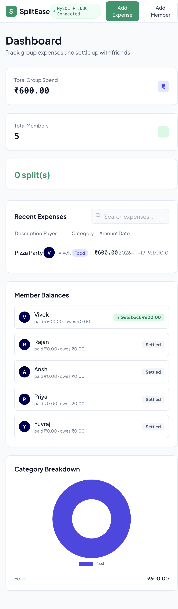
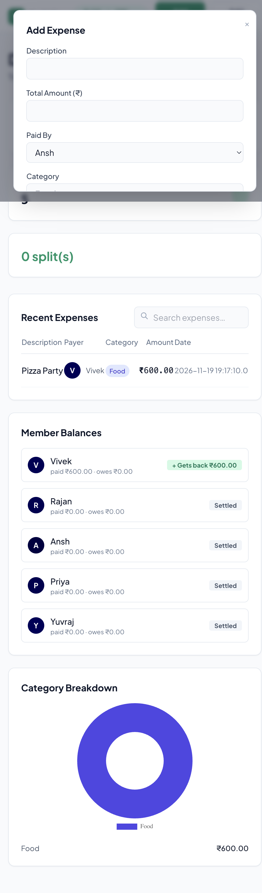
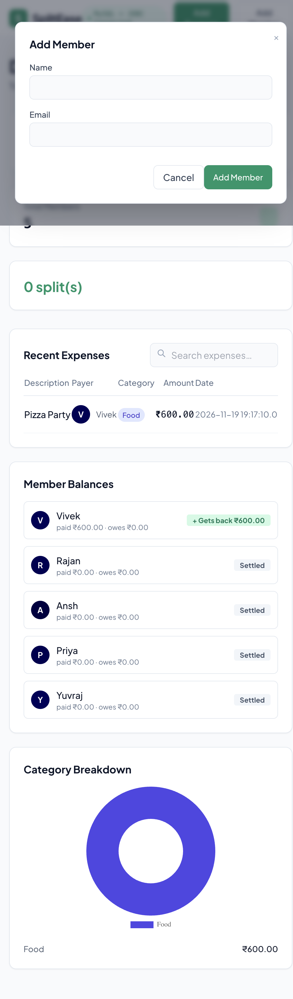

# SplitEase

<div align="center">

**A lightweight expense and split-bill tracker built with Core Java, JDBC, and MySQL**

[](https://www.java.com/)
[](https://www.mysql.com/)
[](https://docs.oracle.com/javase/tutorial/jdbc/)
</div>

SplitEase helps a group track shared expenses, calculate member balances, and settle pending splits. It uses Java's built-in `HttpServer`, direct JDBC queries, and server-rendered HTML with Tailwind CSS and Chart.js.

No Spring Boot, Maven, external application server, or ORM is required.

---

## Dashboard Preview

<p align="center">
  
</p>

<table>
  <tr>
    <td align="center">
      
      <br>
      <strong>Add Expense</strong>
    </td>
    <td align="center">
      
      <br>
      <strong>Add Member</strong>
    </td>
  </tr>
</table>

---

## Features

- Add and manage group members
- Record expenses by payer and category
- Split an expense equally across all current members
- View live total spend and pending settlements
- Calculate paid, owed, and net balances for every member
- Mark one member's pending splits as settled
- Search recent expenses instantly
- Display category spending with a Chart.js doughnut chart
- Store credentials outside source code through `DB_PASSWORD`
- Use a clean, responsive dashboard with modal forms

---

## Technology Stack

| Layer | Technology |
|---|---|
| Language | Java 17+ |
| HTTP server | JDK `com.sun.net.httpserver.HttpServer` |
| Database | MySQL 8 |
| Database access | JDBC, `DriverManager`, prepared statements |
| JDBC driver | MySQL Connector/J 8.4.0 |
| Frontend | Server-rendered HTML, Tailwind CSS |
| Charts | Chart.js |
| Build | `javac` and `java` |

---

## Project Structure

```text
splitease/
├── database/
│   └── schema.sql                  # Database, tables, constraints, and seed data
├── docs/
│   ├── dashboard-preview.png       # Dashboard screenshot
│   ├── add-expense-preview.png     # Add Expense modal screenshot
│   └── add-member-preview.png      # Add Member modal screenshot
├── lib/
│   └── mysql-connector-j-8.4.0.jar # MySQL JDBC driver
├── src/com/splitease/
│   ├── dao/
│   │   ├── CategorySummary.java    # Category chart model
│   │   ├── Expense.java            # Expense model
│   │   ├── ExpenseDAO.java         # SQL and transaction operations
│   │   ├── User.java               # Member model
│   │   └── UserBalance.java        # Balance model
│   ├── db/
│   │   └── DBConnection.java       # JDBC connection configuration
│   └── web/
│       └── MainServer.java         # HTTP routes and dashboard rendering
├── .gitignore
└── README.md
```

`bin/` is generated by the compiler and intentionally excluded from version control.

---

## How It Works

```text
Browser
   │
   │ HTTP GET /  or  HTTP POST /add-expense
   ▼
MainServer
   │
   │ Server-rendered HTML and form handlers
   ▼
ExpenseDAO
   │
   │ PreparedStatement and JDBC transactions
   ▼
MySQL (split_tracker)
   ├── users
   ├── expenses
   └── expense_splits
```

When an expense is added, SplitEase uses a JDBC transaction to:

1. Insert the expense.
2. Fetch all current group members.
3. Divide the amount equally.
4. Insert one `expense_splits` row for every member.
5. Commit the complete operation, or roll back on failure.

---

## Database Setup

### 1. Start MySQL

Make sure MySQL 8 is running on `localhost:3306`.

### 2. Initialize the schema

```bash
mysql -u root -p < database/schema.sql
```

The script:

- Creates the `split_tracker` database
- Creates `users`, `expenses`, and `expense_splits`
- Defines primary and foreign keys
- Seeds Vivek, Rajan, and Ansh as sample members

> The schema script includes `DROP TABLE` statements. Run it only if replacing existing sample data is acceptable.

---

## Build and Run

### macOS or Linux

```bash
# 1. Compile
mkdir -p bin
javac -cp "lib/*" -d bin \
  src/com/splitease/db/DBConnection.java \
  src/com/splitease/dao/*.java \
  src/com/splitease/web/MainServer.java

# 2. Configure MySQL credentials
export DB_PASSWORD='your_mysql_password'

# 3. Start the application
java -cp "bin:lib/*" com.splitease.web.MainServer
```

### Windows (PowerShell)

```powershell
New-Item -ItemType Directory -Force bin | Out-Null
javac -cp "lib/*" -d bin src/com/splitease/db/DBConnection.java src/com/splitease/dao/*.java src/com/splitease/web/MainServer.java
$env:DB_PASSWORD="your_mysql_password"
java -cp "bin;lib/*" com.splitease.web.MainServer
```

Open:

**http://localhost:8080**

If the MySQL root account has no password:

```bash
export DB_PASSWORD=''
```

---

## HTTP Routes

| Method | Route | Description |
|---|---|---|
| `GET` | `/` | Render the dashboard and live balances |
| `POST` | `/add-user` | Add a member |
| `POST` | `/add-expense` | Create an expense and equal splits |
| `GET` | `/settle?user_id=<id>` | Mark a member's pending splits as settled |

---

## Database Configuration

The application connects to:

```text
jdbc:mysql://localhost:3306/split_tracker
Username: root
Password: DB_PASSWORD environment variable
```

The password is not stored in source control. A JVM system property named `DB_PASSWORD` is also supported as a fallback.

```bash
java -DDB_PASSWORD='your_mysql_password' -cp "bin:lib/*" com.splitease.web.MainServer
```

---

## Verification

The application and main browser flows were verified locally:

- Server reachable on port `8080`
- MySQL connection status shown as connected
- Dashboard summary cards load from live database data
- **Add Expense** modal opens and displays correctly
- **Add Member** modal opens and displays correctly
- Expense search filters recent expense rows
- Modal Cancel controls close correctly
- Database-backed expense, member, and category sections render correctly

---

## Troubleshooting

### `Access denied for user 'root'@'localhost'`

Set the correct password before starting Java:

```bash
export DB_PASSWORD='your_mysql_password'
```

### `Unknown database 'split_tracker'`

Initialize MySQL with:

```bash
mysql -u root -p < database/schema.sql
```

### `Address already in use`

Port `8080` is occupied. Stop the previous server or change `PORT` in `MainServer.java`.

### `NoClassDefFoundError` or `ClassNotFoundException`

Confirm the application is compiled and both directories are on the classpath:

```bash
java -cp "bin:lib/*" com.splitease.web.MainServer
```

### Chart or Tailwind assets do not load

The UI uses Tailwind and Chart.js CDN assets. Confirm internet access or replace the CDN scripts with locally hosted assets for a fully offline deployment.

---

## Security and Production Notes

This repository is suitable as a learning project and local demo. Before exposing it to a network:

- Use environment-managed secrets
- Add authentication and authorization
- Validate and limit form input
- Add prepared-statement and transaction error monitoring
- Replace CDN assets with pinned or local assets
- Configure HTTPS and appropriate security headers
- Add automated tests and a real build tool

---

## Contributing

Contributions are welcome.

1. Fork the repository
2. Create a focused feature branch
3. Compile and verify the application
4. Open a pull request with a clear description
